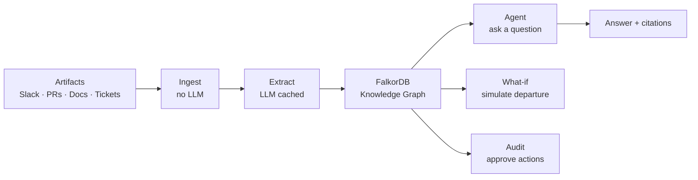

<h1 align="center">Keystone</h1>

<p align="center"><b>Your company's memory, made searchable. Know who knows what, before it walks out the door.</b></p>

<p align="center">
  Keystone builds a living knowledge graph of your organisation — people, artifacts, systems, decisions —
  so you can answer <em>who knows this</em>, <em>what breaks if this person leaves</em>,
  and <em>why was this decided</em>, with cited sources.
</p>

<p align="center">
  <a href="#quick-start"><b>Quick start</b></a> ·
  <a href="#how-it-works"><b>How it works</b></a> ·
  <a href="#the-web-app"><b>Web app</b></a> ·
  <a href="#mcp-server"><b>MCP server</b></a> ·
  <a href="#rebuilding-the-graph"><b>Rebuilding</b></a>
</p>

<p align="center">
  
  
  
  
  
  
</p>

---

## The problem

When someone leaves a company, knowledge leaves with them. Most of what your team knows lives in Slack threads, pull requests, emails, tickets and Confluence pages — not in anyone's head. Keystone reads all of it, builds a graph of who knows what, and answers questions with citations to the actual artifacts.

> *"Who is our last expert on the TitanDB migrations? If they left tomorrow, what would break, and who could cover?"*

That is the question Keystone answers in seconds, with evidence.

---

## What Keystone does



| Who asks | What Keystone answers |
|---|---|
| **Engineering lead** | Who are the experts on System X? Who is the backup? |
| **HR / manager** | If this person leaves, which systems are exposed? Which tickets need a new owner? |
| **Team member** | Why was this architecture decision made? Which document is now out of date? |
| **An AI agent (MCP)** | Any of the above, via the MCP tool API |

---

## How it works

### Graph model

Keystone ingests `data/artifacts.jsonl` — pages, PRs, Slack threads, emails, tickets, meetings — without any LLM call. Then an LLM (cached, so a rebuild costs zero calls) extracts the **systems** and **decisions** each artifact mentions.

- **Who did what.** `AUTHORED` = real authorship (one page, PR, email creator, single thread writer). People in multi-person threads or meetings get `PARTICIPATED {messages}`. `REVIEWED` = PR review. `ASSIGNED` = ticket ownership.
- **Departures** come from HR announcements in the documents themselves ("X's last day is …"). They set `departedDay`, keep the announcing artifact as evidence, and make the person inactive from that day on. Their past work stays in the graph.
- **Expertise (`KNOWS`).** Each person–system pair is scored from the artifacts that mention the system: authored 3, reviewed 2, assigned 1, participated 0.5 × min(messages, 4) / 4 — each with a 30-day exponential decay.
- **Core systems.** A system is *core* when at least 5 artifacts mention it, written by at least 2 people. Bus factor, departure impact and the projection use core systems only.
- **Experts.** A person is an expert on a core system when their score is ≥ 0.4 and at least 25 % of that system's top score.
- **Evidence.** Each `KNOWS` edge keeps the five artifacts most *about* the system: weighted by mention strength, ×4 when the title names the system, divided by how many systems the artifact mentions, so a stack list naming eight systems never leads. Agents see `relativeScore` (1 = the top expert), never the raw score.
- **Memory.** The agent's chats live in the same graph: `(:User)-[:STARTED]->(:Session)-[:HAS_TURN]->(:Turn)`, each Turn `CITED` the artifacts it used and `CONCERNS` the systems and people it was about. A user's correction is a `(:Note)` that `CORRECTS` the Turn, `CONCERNS` the same subjects and is `BASED_ON` its artifacts; only notes a person approved reach the agent. See [Memory](#memory).

### Retrieval

`pnpm embed` splits every artifact body into ~800-character chunks (100-character overlap), embeds them, and writes `(:Chunk)-[:PART_OF]->(:Artifact)` into FalkorDB. Search is hybrid: nearest-neighbour vector lookup plus graph-expansion over `REFERENCES` edges and author links.

### The agent

`POST /agent/ask` answers any question as a stream of Server-Sent Events. It uses the API's own `/mcp` as its tool server, classifies the question (who_knows, why, what_if, freshness, event, visibility, counterfactual, general; event, visibility and counterfactual come with a short tool recipe that ends in a verdict tool, so the graph decides the yes/no), runs up to 5 tool calls, then applies a citation guardrail: artifact ids that no tool returned as evidence are removed. An answer left with no valid citation becomes *"The answer is not in the company's records."* Yes/no questions are answered with Yes or No first; an answer that something did not happen cites the documents that were checked.

---

## Live updates: knowledge that stays current

Org Pulse has a **Post an update** card (`POST /live/artifacts`, admin token when set). A Slack message or a page posted
there goes through exactly the steps of the corpus, then Keystone reports what changed:

1. **Ingest** with the same rules as `artifacts.jsonl` (`IngestService.ingestOne`): roles, links, departure announcements.
2. **Extract** its systems and decisions (one cached LLM call), added without touching anything else.
3. **Link** each new decision to the earlier decisions about the same system it replaces: the 25 earlier decisions that share
   the most rare words are shown to a focused prompt with short ids, and only links from the new decision are kept.
4. **Embed** it for search, then **refresh** expertise (`KNOWS`, active people) and `apex_proj`.
5. **Diff** before and after: decisions replaced, **pages now stale**, systems whose risk level moved, people now inactive.

Example (about 4 s): Jax posts *"we are reverting the TitanDB RDS max_pool_size change … back to 200"*. The postmortem page
`CONF-ENG-187` becomes stale (it still says the pool was lowered to 80), and *"Is the TitanDB connection pool postmortem page
still accurate?"* is answered *"No … [CONF-ENG-187] [LIVE-…]"*. *"Priya's last day is today"* makes Priya inactive: 4 systems
lose their last expert, 8 are left with one, and *"Who should own TitanDB now?"* answers Jax, citing the new message.

Live documents get ids `LIVE-…` and `live: true`. **Undo live updates** (`POST /live/reset`) removes them with their chunks and
decisions, gives back departures and re-activates the decisions they replaced, so the graph is exactly as before. The seed
does not re-ingest them (its link pass is cache-only).

---

## Memory

Keystone remembers what it is asked and what it is told, in the knowledge graph itself (`apps/api/src/memory/`).

| Kind | What is stored | What it changes |
|---|---|---|
| **Episodic** | Every answer is a `Turn` of its chat (`Session`), linked to the artifacts it cited and the systems and people it was about | A follow-up such as *"and if she leaves?"* sees the earlier turns (and their citations stay valid); `GET /memory/sessions?userId=` lists a user's chats |
| **Semantic** | A thumbs-down with a correction becomes a proposed `Note`. After a person approves it (Audit page, admin token) it is added to every question about the same systems or people, and the agent cites it as `[NOTE-…]` next to the documents | *"Who owns TitanDB now?"* → *"Jax took over on-call in March [NOTE-82b8b0be]; the documents still show Priya as the top expert [CONF-…]"* |
| **Shared** | `recall_memory` on the MCP server returns approved notes and how often a subject was asked about | Any MCP client (Claude Desktop, another agent) sees the same company memory |

Keystone proposes, a person approves: no tool can approve a note, so an agent cannot teach itself. Memory is read while the
question is classified and written after the answer; a failure there means an answer without memory, never no answer.
The benchmark builds its agent without memory, so its questions never see each other. Like approved actions, memory is
made by people: it is exported to `exports/memory-latest.jsonl` every 6 hours (`POST /admin/export-memory`) and put back
by `pnpm seed` and `POST /admin/restore`.

| Endpoint | What it does |
|---|---|
| `POST /memory/turns/:id/feedback {"rating", "correction?"}` | 👍 / 👎 on an answer (`turnId` comes with the `done` event); a correction proposes a Note |
| `GET /memory/notes?status=` | Notes with the question they correct, their subjects and evidence |
| `POST /memory/notes/:id/approve` · `/reject {"reason"}` | A person's decision (admin token) |
| `GET /memory/about?name=` | What Keystone remembers about a system or person |
| `GET /memory/sessions?userId=` | A user's chats, newest first |

---

## Repository layout

| Path | What it is |
|---|---|
| `apps/api` | NestJS 11 API (port 4000). The only service that talks to FalkorDB. |
| `apps/web` | Next.js 15 web app (port 3000). |
| `packages/shared` | Zod schemas and types shared by both apps. |
| `scripts/` | Python data preparation (`prepare_orgforge.py`). |
| `docker-compose.yml` | Local FalkorDB (6379 + Browser on 3100) and Redis for BullMQ (6380). |
| `docker-compose.prod.yml` | Production stack on one EC2 instance: FalkorDB, Redis, API, worker, Caddy ([docs/deploy.md](docs/deploy.md)). |
| `deploy/` | Caddyfile (HTTPS, SSE) and the optional FalkorDB Browser site. |
| `docs/` | Cypher query reference, MCP integration guide, deployment guide, development notes. |

---

## Quick start

Needs **Node ≥ 22**, **pnpm ≥ 10**, and **Docker**.

```bash
cp .env.example .env          # set FALKOR_PASSWORD and an LLM key (GEMINI_API_KEYS or OPENAI_API_KEY)
docker compose up -d          # FalkorDB on :6379 (Browser on :3100) and Redis on :6380
pnpm install
pnpm dev                      # API on :4000, web on :3000
```

Then ingest and build the graph:

```bash
# 1. Ingest artifacts (no LLM)
curl -X POST http://localhost:4000/ingest/full

# 2. Extract systems and decisions (LLM, cached)
pnpm extract

# 3. Compute expertise and projections
pnpm expertise

# 4. Build embeddings for hybrid search (LLM, cached)
pnpm embed

# 5. Final expertise refresh
pnpm expertise
```

Open **http://localhost:3000** for the Org Pulse dashboard, **http://localhost:3100** for the FalkorDB Browser.

---

## Commands

| Command | What it does |
|---|---|
| `pnpm dev` | Builds shared, then runs shared (watch), API and web in parallel |
| `pnpm build` | Builds every package |
| `pnpm test` | Unit tests (no Docker needed) |
| `pnpm --filter @keystone/api test:int` | Integration tests against the running FalkorDB |
| `pnpm lint` | ESLint everywhere |
| `pnpm capability-check` | PASS/FAIL for every FalkorDB feature Keystone needs |
| `pnpm extract [--dry-run]` | Extract systems and decisions with the LLM (cached) |
| `pnpm embed [--dry-run]` | Build retrieval chunks and embeddings (cached) |
| `pnpm reingest-roles` | Rewrite person–artifact role edges, then refresh expertise |
| `pnpm seed [--force]` | Rebuild `apex` from files only (zero LLM/embedding calls); `--force` even if it has data. Runs compiled: `pnpm --filter @keystone/api build` first |
| `pnpm ask "question"` | Ask the agent from the command line (API must be running) |
| `pnpm bench [--only=b1\|b2] [--dry-run] [--yes] [--out=name]` | Benchmark: departure prediction (B1) and question answering vs a vector-only baseline (B2) |
| `pnpm bench --publish=name` | Publish `data/bench/name.json` as the site's results (`apps/api/bench-results/`, tracked) |
| `pnpm --silent mcp:stdio` | The Keystone MCP server over stdio |
| `pnpm mcp:check [--stdio]` | List MCP tools and call the read tools |
| `pnpm systems report` | System catalog: distribution by mentions and authors |
| `pnpm expertise [--as-of N]` | Recompute `KNOWS` + `COLLAB`, rebuild `apex_proj` |
| `pnpm llm-check` | Verify one cached JSON call + one embedding with the configured LLM |

---

## Rebuilding the graph

Everything is rebuilt from `data/artifacts.jsonl` and the caches in `DATA_DIR` (extraction, LLM answers, embeddings), so a rebuild costs zero LLM calls. Order:

1. `POST /ingest/full` — people, artifacts and role edges (no LLM)
2. `pnpm reingest-roles` — only when upgrading an existing graph to new role rules
3. `pnpm extract` — systems, decisions, `SUPERSEDES`/`ASSERTS` (cached)
4. `pnpm expertise` — system statistics and core flags, `KNOWS`, `COLLAB`, `apex_proj`
5. `pnpm extract --relink-stale` — targeted stale-page pass on core systems (cached; needs core flags from step 4)
6. `pnpm embed` — chunks and embeddings (cached)
7. `pnpm expertise` — final refresh of `KNOWS`, `COLLAB` and `apex_proj`

Set `LLM_CACHE_ONLY=yes` to turn any cache miss into an error, proving a run made no LLM calls.

**In one command: `pnpm seed`.** It runs the same stages (plus restoring approved actions from
`DATA_DIR/exports/actions-latest.jsonl`) into a staging graph `apex_seed` and renames it over `apex`
only when everything succeeded. Its LLM layer is cache-only with a provider that cannot reach any
API, and every extraction and embedding entry is checked before the first write: if one is missing,
it stops with the full list of missing ids and leaves `apex` untouched. The API runs it by itself at
startup when `apex` is empty and there is no `apex_backup` to restore (`GET /health` says `"seeding"`).

---

## LLM provider

All LLM calls go through `LlmService` (`apps/api/src/llm/`):

| Provider | Env vars | Default models |
|---|---|---|
| **OpenAI** | `USE_OPENAI=yes`, `OPENAI_API_KEY` | `gpt-5-nano` (extraction), `text-embedding-3-small` (embeddings) |
| **Gemini** (default) | `GEMINI_API_KEYS` (comma-separated, rotated) | `gemini-2.5-flash`, `gemini-embedding-001` |

Every response is Zod-validated and cached in `DATA_DIR/llm-cache`. Embeddings are shortened to `EMBED_DIM` (768) on both providers. Verify setup with `pnpm llm-check`.

---

## Extraction

LLM extraction lives in `apps/api/src/extract/`. It selects pages, threads, PRs, emails and meetings with a body over 300 characters, plus every ticket, seeds a system-name vocabulary from artifact text and the hand-editable `aliases.json`, then:

1. Per artifact: systems (`MENTIONS {weight}`), decisions (`DECIDED_IN`, `ABOUT`) and page claims.
2. Per system with 2+ decisions or claims: `SUPERSEDES` between decisions and `ASSERTS` from pages.

| Command / endpoint | What it does |
|---|---|
| `pnpm extract --dry-run` | Plan and cost estimate; no LLM calls, no writes |
| `pnpm extract --limit 50` | Trial on 50 artifacts spread across types |
| `pnpm extract [--force] [--refresh]` | Full run |
| `pnpm extract --relink-stale` | Targeted second pass for stale pages on core systems |
| `POST /extract/run` | Same, as a BullMQ job; follow `GET /extract/jobs/:id/events` |

### System catalog

The catalog (`apps/api/src/catalog/`) writes `mentionCount`, `authorCount`, `core` and `idf` onto every System. A system is **core** when ≥ `CORE_MIN_MENTIONS` (5) artifacts mention it, written by ≥ 2 people. `idf = log(totalArtifacts / (1 + mentionCount))` makes niche systems rank higher when suggesting ticket owners.

---

## Expertise and analytics

`POST /analytics/refresh-expertise` (or `pnpm expertise`) runs a BullMQ job that:

1. Materialises `KNOWS` edges (recency-weighted, 30-day decay, computed in Cypher); edges below 0.05 are deleted.
2. Rebuilds `COLLAB` (collaboration graph).
3. Rebuilds the small projection `apex_proj` (Person, core System, `KNOWS`, `COLLAB` pairs at or above median weight; ~1 MB vs 47 MB for the full graph).

| Endpoint | What it returns |
|---|---|
| `GET /systems/:name/experts` | Top experts + evidence graph |
| `GET /systems/:name/decisions` | Decision trace (what replaced what, source, authors) |
| `GET /people/:name/departure-impact` | Systems + backups, open tickets + suggested owners, sole-authored pages |
| `GET /analytics/bus-factor` | Systems with 0, 1 or 2 experts (orphaned / critical / watch) |
| `GET /analytics/bridges` | Top 10 people who connect teams (betweenness on `COLLAB`) |
| `GET /analytics/central-people` | Top 10 people at the centre of the network (PageRank on `COLLAB`) |
| `GET /analytics/stale-docs` | Pages still asserting a superseded decision |
| `GET /analytics/summary` | Dashboard figures: people, systems by risk level, stale docs, memory |

---

## What-if: simulating a departure

`POST /whatif/departure {"person": "…"}` answers *"what if this person leaves?"* without touching the live graph. It copies the small projection `apex_proj` (~1 MB) into a scratch graph using `GRAPH.COPY`, removes the person, and compares bus factor, bridges and knowledge islands before and after.

- The scratch graph is always deleted (also on errors); a sweeper at startup and every hour removes leftover `apex_whatif_*` graphs.
- At most `WHATIF_MAX_CONCURRENT` (2) simulations run at once; two requests for the same person share one run.
- `GET /whatif/candidates` returns the 10 people whose departure would orphan the most core systems.

---

## Proposed actions and approval

Keystone proposes; a person approves. Every proposal is an `(:Action)` node: `kind` (`reassign`, `runbook`, `review_doc`, `handover`), `status` (`proposed`, `approved`, `rejected`), the day, the reason, and the artifacts that justify it.

| Endpoint | What it does |
|---|---|
| `POST /actions/handover {"person"}` | Drafts a full handover plan from the departure simulation |
| `GET /actions?status=` | Lists all actions, newest first, with target, assignee and evidence |
| `GET /actions/:id/why` | The audit trail of one action |
| `GET /actions/:id/graph` | The same trail as a drawable graph |
| `POST /actions/:id/approve` | Approves (admin token); moves the ticket's `ASSIGNED` edge |
| `POST /actions/:id/reject {"reason"}` | Rejects with a reason (admin token) |

**Why did Keystone suggest this?** One Cypher query (`WHY_SUGGESTED`) walks the action's edges: what it targets, the handover plan it belongs to, every `BASED_ON` artifact, and the assignee's `KNOWS` scores. Because suggestions are nodes in the same graph as the evidence, the audit trail is a graph traversal.

---

## Benchmark

**Latest run** (78 questions, same model `gpt-5-nano` and same 60k-character context for both, blinded judge;
full report: [`apps/api/bench-results/results.md`](apps/api/bench-results/results.md)):

| | Keystone (graph + agent) | Vector-only RAG |
|---|---:|---:|
| Accuracy (95% CI) | **72%** (61–81) | 24% (16–35) |
| Right where the other is wrong (paired) | **42** | 5 (sign test p < 0.001) |
| Gold evidence in front of the model | **53%** | 17% |
| Declined to answer | 1 of 78 | 27 of 78 |

Keystone is ahead on every question type: counterfactual 62% vs 14%, perspective 80% vs 27%, silence 70% vs 30%.

`pnpm bench` measures Keystone against the OrgForge answer key. `apps/api/src/bench/` is the **only** code allowed to
read `data/answer_key/`: an ESLint rule (API and web) and a repo-wide Jest test (`answer-key-guard.spec.ts`) fail if
anything else names the folder or imports its reader. The answer key is read only to pick questions and to score
answers after both systems have answered; it never reaches the graph, the agent's tools, embeddings or their prompts.

- **B1, departure prediction.** For each departure inside the simulated days, `ProjectionService.rebuild('bench_proj_<day>', { asOfDay: day - 1 })`
  builds a small projection, departure impact (K5, default minScore) runs on it, and the projection is deleted in a
  `finally` (one at a time). The systems K5 lists are matched to the person's knowledge domains: aliases.json and
  normalisation, then fuzzy matching, then an LLM *"are these two names the same system? yes/no"* for leftover pairs.
  Precision, recall and F1 per departure and micro-averaged. Departures before day 1 are checked against bus factor
  (K4) on `apex_proj`: do their domains show up as orphaned or critical (recall)?
- **B2, question answering.** Up to `BENCH_PER_TYPE` questions per type, sampled with a fixed seed, each answered
  twice with the same model and the same context budget (5 tool results x 12,000 characters): Keystone through
  `AgentService.ask` (non-streaming), and a baseline that pastes the top-k `vectorOnlySearch` chunks into one prompt
  (*"answer only from these documents and cite ids"*). Gold ids are matched exactly against cited ids, names by
  normalised string match, anything else by a blinded LLM judge that sees one candidate at a time, never which system
  wrote it. Proposing actions is disabled during the run, so it writes nothing to `apex`. For yes/no gold answers the
  judge works in two steps: once per question it states the correct Yes/No to the question as worded (wording such as
  "would X still have happened?" settles it by rule), then a candidate that opens with Yes or No is compared with that
  directly; anything else is judged free-form.
- The CLI prints the question file's fields, types and an example per type, then the planned number of LLM calls,
  and asks before going over 1,500 (`--yes` skips the question; `--dry-run` stops there).
- Output: `data/bench/results.json` (everything) and `data/bench/results.md` (tables, and a plain statement with a
  one-line hypothesis wherever the baseline wins or ties). `--out=name` writes `name.json` / `name.md` instead, e.g. to
  keep a run with another model next to the main one.
- **Published results** live in `apps/api/bench-results/` (tracked by git, copied into the API image). `GET /bench/results`
  and the `/bench` page read them first, so a new run reaches the deployed site with a commit, not an upload of `data/`.
  A run without `--out` updates them; `pnpm bench --publish=name` publishes a named run (no LLM calls; B1 is kept from the
  current results when the run has none).
- Every accuracy comes with a 95% confidence interval (Wilson), and the two systems are compared **paired** on the
  same questions: how many only Keystone got right, how many only the baseline did, and an exact sign-test p-value.
  `BENCH_PER_TYPE=30` runs all 78 questions of the answer key (21 counterfactual, 30 perspective, 27 silence).
- Every run also records, per question, the tool calls and the artifact ids each system had in front of it, and the
  **evidence recall** (share of the answer key's evidence artifacts among them), plus a hindsight reference row:
  the accuracy of always giving each type's most common gold yes/no.
- The judge (and B1's "same system?" checks) uses the systems' model unless `BENCH_JUDGE_MODEL` names another.
- B1 also scores a second predictor next to K5, **knowledge share**: systems (core or not, named in 3+ documents)
  where the person holds at least a quarter of everyone's knowledge as of the day before, thread participation included.

---

## The web app

`apps/web` (Next.js 15 App Router, Tailwind, shadcn/ui) follows the layout of our Intake app:
a permanent sidebar that retracts to an icon rail (a drawer on phones), pill navigation, white
cards on a slate background, heavy Inter titles and light descriptions. Keystone's own colours:
a navy ink for what is selected or primary, and one vermilion signal used only for risk and the
agent's path; monospace only for ids. Light and dark mode come from CSS variables; the toggle
sets a `dark` class on `<html>`, saved in `localStorage` and applied before first paint.

| Page | What it shows |
|---|---|
| `/` **Org Pulse** | Summary figures, core systems grouped by risk (click for experts and evidence path), bridge people, and a replay control |
| `/ask` **Ask** | Chat on the left, force-graph canvas on the right; tool calls as a step list while the answer streams, citations as chips |
| `/whatif` **What-if** | Person picker, graph around them, simulated departure in three animated beats, impact report, handover plan |
| `/decisions` **Decisions** | Systems with decisions, a timeline where replaced decisions are struck through |
| `/audit` **Audit** | Every proposal, filterable by status and kind; approve or reject from the UI |
| `/bench` **Benchmark** | Accuracy by question type, Keystone and vector-only side by side (sample size per type), and the departure-prediction scores |

---

## MCP server

Keystone exposes its knowledge graph as an [MCP](https://modelcontextprotocol.io) server — any MCP client (Claude Desktop, MCP Inspector, your own agent) can use it.

Two transports, same tools:

| Transport | How to reach it |
|---|---|
| Streamable HTTP | `POST http://localhost:4000/mcp` while the API runs |
| stdio | `pnpm --silent mcp:stdio` |

### Tools

| Tool | What it does |
|---|---|
| `search_knowledge` | Hybrid search: passages with artifact id, title, type, day, authors (optional day range) |
| `find_artifacts` | Documents by people involved, day range, type, title or text |
| `get_artifact` | One document with everyone involved (and how), its links in both directions and the start of its text |
| `what_followed` | What came after a document: linked documents and the same people's later work |
| `find_event` | The documents of one event, ranked by people, rare words, document type and day |
| `check_follow_up` | Verdict from the graph: did a response of a given kind follow a document? |
| `check_visibility` | Verdict in one call: could a person have known about an event by a day? (finds the event without them, then checks involvement) |
| `check_involvement` | Verdict from the graph: was a person part of these documents by a given day? |
| `check_causal_link` | Verdict from the graph: linked, likely (soon after, same people) or no evidence |
| `who_knows` | Top 5 experts on a system, with scores and evidence |
| `bus_factor` | Systems with 0, 1 or 2 experts (orphaned / critical / watch) |
| `bridge_people` | Top 10 people who connect teams |
| `how_connected` | Shortest chain between two people or systems (`algo.SPpaths`), with the documents on it |
| `central_people` | The people at the centre of the collaboration network (`algo.pageRank` on `COLLAB`) |
| `simulate_departure` | What breaks if someone leaves |
| `trace_decision` | A system's decisions, newest first, with what they replaced |
| `find_stale_docs` | Pages that still state a superseded decision |
| `list_systems` | Core systems with mention counts |
| `list_people` | People with department and activity |
| `draft_handover` | Proposes a handover plan (propose-only; a human approves) |
| `propose_reassignment` | Proposes moving a ticket to a person |
| `create_runbook_task` | Proposes a runbook task for a sole expert |
| `recall_memory` | Approved notes from colleagues and how often a system or person was asked about |

**Show Cypher.** `GET /queries` maps every tool to the exact Cypher constants it runs (`apps/api/src/mcp/tool-queries.ts`);
in Ask, each step of an answer has a *Cypher* chip that shows them.

Every tool returns `{ data, evidence, graphPath? }`. `evidence` holds artifact ids to cite; `graphPath` is an optional small graph to draw. See [docs/mcp.md](docs/mcp.md) for Claude Desktop config and MCP Inspector instructions.

---

## Ingestion

Deterministic, no LLM: `data/artifacts.jsonl` → FalkorDB through a BullMQ queue on a separate Redis.

In dev the API runs the worker itself (`INGEST_WORKER_INLINE=true`). In production the `worker` container runs `node dist/worker.js`.

| Endpoint | What it does |
|---|---|
| `POST /ingest/full {"graph":"apex"}` | Rebuild `apex` from scratch with every artifact |
| `POST /ingest/replay {"fromDay":1,"toDay":5}` | Rebuild `apex_replay` one day at a time |
| `GET /ingest/jobs/:id/events` | Server-Sent Events: live progress until completed/failed |
| `GET /ingest/events` | SSE for every job (the web app's live dot and replay strip) |

---

## Environment variables

Copy `.env.example` to `.env`. Key variables:

| Variable | Default | Purpose |
|---|---|---|
| `FALKOR_PASSWORD` | *(required)* | FalkorDB password |
| `USE_OPENAI` | `no` | `yes` to use OpenAI; `no` to use Gemini |
| `OPENAI_API_KEY` | — | OpenAI key (when `USE_OPENAI=yes`) |
| `GEMINI_API_KEYS` | — | Comma-separated Gemini keys (rotated) |
| `EMBED_DIM` | `768` | Embedding vector dimension |
| `CORE_MIN_MENTIONS` | `5` | Minimum artifact mentions for a system to be "core" |
| `WHATIF_MAX_CONCURRENT` | `2` | Maximum simultaneous departure simulations |
| `LLM_CACHE_ONLY` | `no` | `yes` to make a cache miss an error (proves zero LLM calls) |
| `ADMIN_TOKEN` | — | When set, `POST /ingest/*` and `POST /actions/:id/approve` require `x-admin-token`; `POST /admin/*` is disabled until it is set |
| `TEXT_STORE` | `local` | `local` or `s3` (artifact bodies and chunk text live here, not in the graph) |
| `BENCH_PER_TYPE` | `15` | Benchmark questions sampled per question type |
| `BENCH_SEED` | `13` | Benchmark sampling seed (same seed, same questions) |
| `BENCH_JUDGE_MODEL` | the system model | Optional: the model that judges answers and checks B1 names |

The web app has its own settings in `apps/web/.env.local` (copy `apps/web/.env.example`; on Vercel, Project Settings → Environment Variables):

| Variable | Default | Purpose |
|---|---|---|
| `NEXT_PUBLIC_API_BASE_URL` | `API_BASE_URL` from the root `.env`, else `http://localhost:4000` in dev | The API the browser calls. Baked in at build time; a production build fails if it is not set |

---

## Deployment

One EC2 instance runs `docker-compose.prod.yml`; the web app runs on Vercel. Step by step:
**[docs/deploy.md](docs/deploy.md)**. Redeploy with `scripts/deploy.sh ubuntu@<elastic-ip>`.

| Endpoint / job | What it does |
|---|---|
| `GET /health` | `status`: `up`, `seeding` (apex being restored or rebuilt), `degraded` (apex empty) or `down` |
| `POST /admin/backup` | Copy `apex` to `apex_backup` now; the old backup is replaced only once the copy succeeded (the worker also does it every 6 hours) |
| `POST /admin/restore` | Replace `apex` with `apex_backup`, merge the latest actions export back, rebuild `apex_proj` |
| `POST /admin/export-actions` | Write every Action with its edges to `exports/actions-<timestamp>.jsonl` and `actions-latest.jsonl` (also every 6 hours) |

All `/admin/*` endpoints need `x-admin-token: <ADMIN_TOKEN>`.

---

## Tech stack

| Layer | Technology |
|---|---|
| Graph database | [FalkorDB](https://www.falkordb.com) v4.22.1 |
| API | NestJS 11, TypeScript, Zod |
| Queue | BullMQ on Redis 7 |
| Web | Next.js 15 (App Router), Tailwind CSS, shadcn/ui |
| Graph visualisation | react-force-graph-2d |
| LLM (extraction + agent) | OpenAI `gpt-5-nano` or Gemini `gemini-2.5-flash` |
| Embeddings | OpenAI `text-embedding-3-small` or Gemini `gemini-embedding-001` |
| MCP | [Model Context Protocol](https://modelcontextprotocol.io) — Streamable HTTP + stdio |
| Monorepo | pnpm workspaces |
| Container | Docker Compose |
